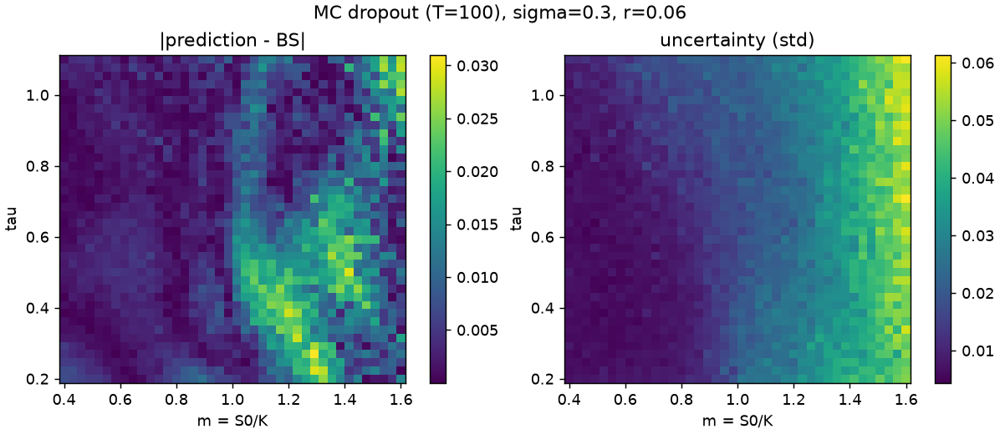

# ML for Option Pricing

Neural networks that learn the **Black–Scholes pricing function** of a European call,
with **uncertainty quantification** (deep ensembles and Monte-Carlo dropout).

> Project from the *Machine Learning & Econometrics* course (NTHU, 2025), re-implemented as a
> clean, tested and reproducible codebase.

## Why synthetic data?

The original plan was to learn directly from **TSMC option chains**. Free sources turned out to
be incomplete (missing quotes, inconsistent strikes and maturities, unreliable implied
volatilities), far too noisy for deep learning. The project therefore follows the
"learning the pricing formula" approach: generate clean options in a realistic parameter
domain, price them with Black–Scholes, and train networks to approximate the mapping.
Because the true price is known, model error can be measured exactly.

## Problem

Inputs: moneyness `m = S0/K`, time to maturity `τ`, risk-free rate `r`, volatility `σ`.
Target: scaled call price `π = C/K`.

| Parameter | Range |
|---|---|
| `m` | 0.4 – 1.6 |
| `τ` (years) | 0.2 – 1.1 |
| `r` | 0.02 – 0.10 |
| `σ` | 0.01 – 1.00 |

## Models

| Model | Description |
|---|---|
| MLP | 4 → 50 → 50 → 1, dropout 0.1 |
| Residual | MLP with a skip-connection |
| Highway | MLP with a learnable gate |
| Deep ensemble | N networks with different seeds → mean and spread |
| MC dropout | Dropout kept active at inference → predictive distribution |

## Results

All numbers are measured against the **exact Black–Scholes price** (`π = C/K`), seed 42,
5000/1000/1000 train/val/test split, scaler fit on train only. Each table states which split it
uses; the test split is used only for the final MC-dropout evaluation, never to choose hyperparameters.

### 1. The original optimiser under-fits (validation split, MLP, 100 epochs)

| config | val RMSE | val MAE | val median rel. err | best epoch | final train MSE |
|---|---|---|---|---|---|
| SGD lr=1e-4 (original report) | 1.737e-01 | 1.507e-01 | 4.996e-01 | 99 | 3.244e-02 |
| **Adam lr=1e-3** | **8.141e-03** | **6.209e-03** | **2.847e-02** | 34 | 5.506e-04 |
| Baseline (train mean) | 2.180e-01 | 1.884e-01 | 6.133e-01 | - | - |

With the report's SGD configuration the network barely beats the constant baseline within 100
epochs (best epoch = last epoch: still improving). Adam reduces the RMSE by ~21x, so all the
following experiments use Adam lr=1e-3.

### 2. Deep ensemble vs single network (validation split, N=5, MLP)

| model | RMSE | MAE | median rel. err |
|---|---|---|---|
| single model (mean over the 5 members) | 8.106e-03 | 6.276e-03 | 2.501e-02 |
| **ensemble (N=5)** | **5.769e-03** | **4.245e-03** | **1.554e-02** |

Averaging 5 networks cuts the RMSE by ~29 % and the median relative error from 2.5 % to 1.6 %.

### 3. Monte-Carlo dropout (test split, T=100 passes)

| RMSE (deterministic) | RMSE (MC mean) | MAE (MC) | median rel. err (MC) | mean std | coverage 95 % |
|---|---|---|---|---|---|
| 8.347e-03 | 1.267e-02 | 9.618e-03 | 4.879e-02 | 2.663e-02 | 1.000 |

The nominal 95 % interval covers **100 %** of test points: MC dropout (p = 0.1) is
**over-conservative** here, and its mean is less accurate than the deterministic forward pass.

### 4. Is uncertainty larger at the edges of the domain? (grid over (m, τ), σ=0.3, r=0.06)

Reported as edge/interior ratios (1.00 = no edge effect) per border (`m_low`, `m_high`,
`tau_low`, `tau_high`) for the std, the absolute error and the relative error, as
mean ± std over 3 seeds (42, 142, 242), plus Spearman(std, err). Generate the exact table with
`python -m option_pricing.uncertainty_maps`; it is written to `outputs/` (git-ignored).
The numeric table previously shown here could not be traced to the output of this script and was removed.

Note: the MC dropout map uses **member 0 of the ensemble** (same network), so the
ensemble vs MC dropout contrast should be read with that caveat.




### 5. Towards market data

TSMC daily prices can be downloaded reproducibly (`scripts/download_tsmc.py`, extra `market`) and
`option_pricing.historical_vol` compares rolling realised volatility (21/63 days) with the `σ`
range of the synthetic domain.

### Limitations

- Tables 1–3 use a single seed (42) and a single 5000/1000/1000 split: no confidence intervals. Section 4 is averaged over 3 seeds.
- Tables 1–2 are on the validation split, table 3 on the test split; they are not directly comparable.
- Residual and Highway architectures are implemented (`models.py`) but only the MLP is reported above.

## Reproduce the figures

```bash
pip install -e ".[dev]"          # 1. install
pytest -q                        # 2. run the tests (< 30 s)
python -m option_pricing.uncertainty_maps   # 3. section 4 only: train ensemble + MC dropout, write figures to docs/figures/
```

Other entry points: `python -m option_pricing.optimizer_study` (table 1),
`python -m option_pricing.uncertainty` (table 2), `python -m option_pricing.mc_dropout --split test` (table 3),
and `notebooks/demo.ipynb` for a guided tour.

## References

- F. Black, M. Scholes (1973). *The Pricing of Options and Corporate Liabilities*. Journal of Political Economy, 81, 637–654.
- L. van Mieghem, A. Papapantoleon, J. Papazoglou-Hennig (2023). *Machine learning for option pricing: an empirical investigation of network architectures*. [arXiv:2307.07657](https://arxiv.org/abs/2307.07657)
- J. Hull (2020). *Machine Learning in Business: An Introduction to the World of Data Science*.
